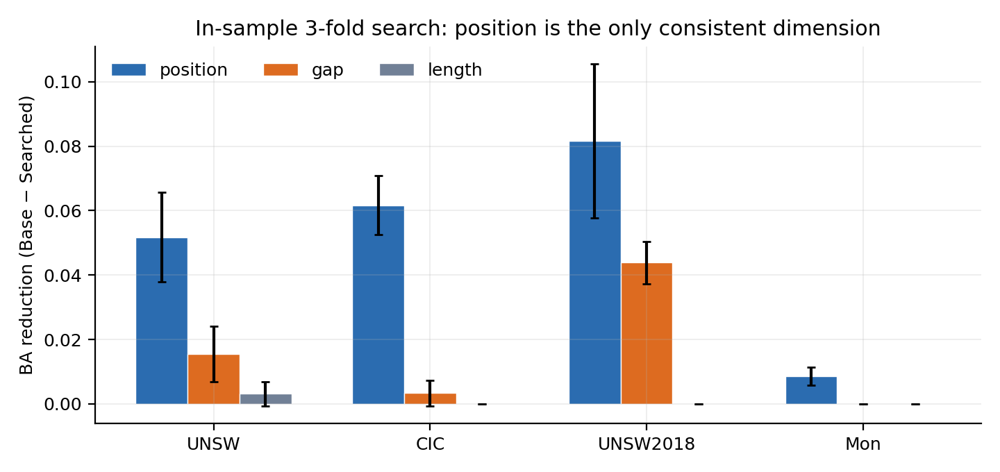
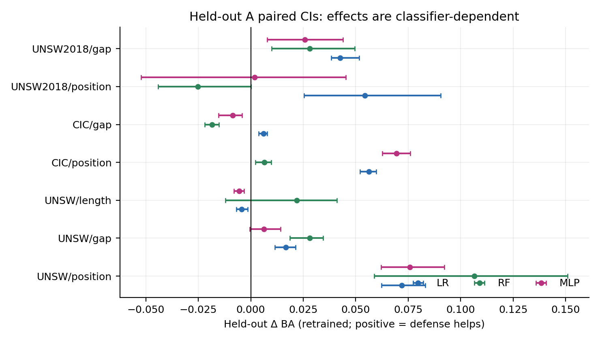
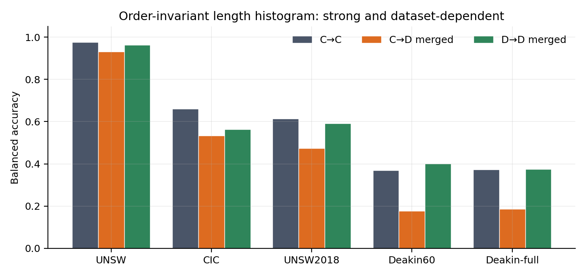
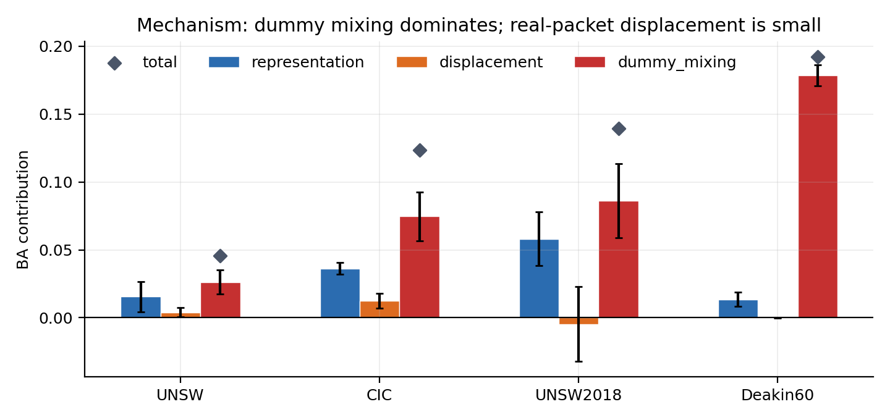
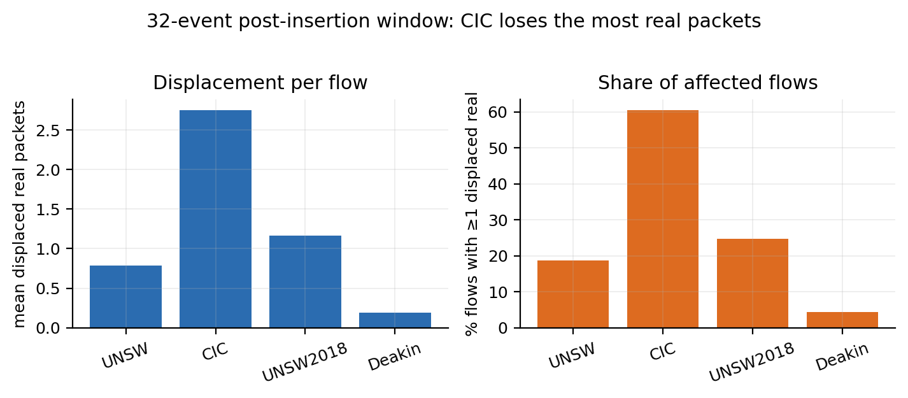
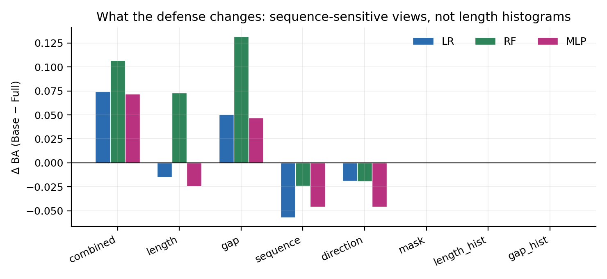

# AGENT.md — FADE 设备指纹防御项目交接

> 给后续 agent 的最短路径。仓库根目录：`code打包/`；分支：`stage2-coordination`。

## 1. 一句话

FADE 在固定 32-event 观察窗口内，用**真实包 padding、dummy 插入、位置选择、插入后截断**改变流量表示；当前研究主线已从“mapping rotation 能否破坏身份”转为“攻击者要多少标签、多少时间、多少历史知识才能完成在线适应”。

### 协议已冻结（2026-11-07）

- **P5-150**：已知 5 类（1/2/3/5/7），150 观测日；只做闭集 5 类评估。
- **P8-48**：已知全部 8 类，2017-02-23 起 48 观测日；唯一合法的“初始认识 8 类”协议。
- **P8-open/增量**：可选，暂不启动；不能与 P8-48 混表。
- 历史 UNSW 150 日结果（Full New5 0.7683/0.8818 等）是 **5 类 warmup + 8 类 target**，不能证明“初始认识 8 类”。
- 不再启动 Weakener / Hybrid 参数搜索。
- 详见 `docs/实验协议冻结_三类覆盖.md`。

## 2. 代码怎么看

按这个顺序读，不要从 scripts 开始：

1. `methods/method33.py`
   - `Method33Config`：预算、trigger code/positions、mapping、weakener 配置。
   - `resolve_trigger_positions()`：位置唯一性、1-based、递增。
   - `apply_method33_base()`：真正的 FADE 执行流程。
     - 真实包 padding；
     - weakener dummy 插入；
     - trigger 两包插入（`source_index+1`，即真实包之后）；
     - **插入后截断到 32 events**；
     - stats/audit。
   - `apply_method33()`：jitter 包装；per-flow RNG 由内容 token 决定，chunk/order 不变。
2. `methods/method33_tools.py`
   - 配置加载/校验、CLI、预算检查、mapping 是 permutation/derangement。
3. `configs/methods/*.json`
   - `fade_unsw8_pos_v2.json`、`fade_cic9_pos_v2.json` 是当前主配置。
4. `scripts/`
   - 每个实验一个 runner；结果写 `artifacts/es/*.json`。
5. `docs/`
   - 结论与设计；优先看 `第一阶段总结_v2.md`、`第二阶段_FeatureCanonical.md`。

### 关键不变量

- 窗口固定 32 events；截断发生在所有插入之后。
- 等成本上限：`630 B / 1.5 s / ≤6 dummies`。
- 当前分解：weakener `347 B / 1.05 s / 3` + trigger `283 B / 0.45 s / 2`。
- trigger 恰好 2 包、一对/类；位置由 `trigger_positions[code_index]` 决定。
- `mapping` 是 class→code index 的置换；`next_mapping` 必须是 derangement。
- `max_frame_length=1514`；原始数据可能有 1518，实验脚本会 clip。
- 实验性 per-flow 位置用 `trigger_position_override`，默认行为不变。

### 最容易踩的坑

- `trace`（`complete_event_trace`）只应用于 **oracle/known-mapping** 分析；adaptive 不能读 trace，否则泄漏。
- `features()` 的 gap 是事件 outgoing gap，**第 0 个 gap 强制为 0**；不要用 trace 的 `gap_seconds` 直接重建。
- 短流 trigger 会 fallback 到末尾；重插入时必须在“最后一个 real 之后、weakener 之前”。
- UNSW 按类别排序明显：按流顺序取“前 50%”常是单类；calibration 必须按时间切 block 后再分层。
- UNSW 20-day block 的 calibration pool 也**不覆盖全部 8 类**；class 4 常缺席。
- `n=64` 在 20-day block 常只覆盖 1 类，不能当 selector 失败。

## 3. 实验时间线

| 阶段 | 做了什么 | 主要文档 |
| --- | --- | --- |
| Phase 1 | 等成本位置/长度/gap 搜索 + 消融归因；v2 固定 RNG | `docs/第一阶段总结_v2.md` |
| Phase 1 机制 | CC→CD_complete→CD_visible→CD_merged；dummy mixing / displacement / representation | `docs/第一阶段实验结论.md` |
| Stage A.1/A.2 | Real vs Placebo trigger；padding-matched T0；固定 5 事件 T1W3 vs T0W5 | `docs/第二阶段_StageA1_A2.md` |
| Position placebo | 类位置 vs per-flow 随机位置；A/B/C/D | `docs/第二阶段_PositionPlacebo.md` |
| 失败诊断 | per-class recall、confusion、validation permutation、rotation α | `docs/第二阶段_失败诊断与位置剂量.md` |
| K 稳定性 | K=1/2/4/8 类内位置池；位移分层；position-only 对齐 | `docs/第二阶段_位置稳定性K.md` |
| 时间序列 pilot | Fixed/Periodic/Per-flow；J、T_first/sustained、T_recovery | `docs/第二阶段_时间序列pilot.md` |
| 校准曲线 | permutation / probe / finetune；n=64…1024 | `docs/第二阶段_校准曲线.md` |
| 在线适应 | v2 共享状态模型、位置似然；Adaptive pilot 失败 | `docs/第二阶段_在线适应v2.md` |
| 特征逆变换 | target-level、oracle feature、observed inverse、序列重构 | `docs/第二阶段_FeatureCanonical.md` |
| 跨数据集/模型 | CIC、RF、MLP；multi-phase/seed；selector | `docs/第二阶段_FeatureCanonical.md` |
| 类别适应 | Block6/7 负迁移、Common-class BA、support audit | `docs/第二阶段_FeatureCanonical.md` |

## 4. 已经比较确定的结论

1. **位置/序列表示是 mapping rotation 的主要可逆损失来源。**
   - Oracle canonicalization：Fixed/Periodic/Per-flow 都 ≈ **0.884**。
   - Position-only inverse：约 **0.877**；Combined：**0.884**。
   - Code-only：约 **0.711**，贡献小。

2. **Rotation 不是不可逆信息破坏。**
   - Known mapping + 正确序列重构可回到 Fixed 水平；
   - Target-level 逆映射不够，必须 feature-level。

3. **Learned position mapping 是关键。**
   - K=1 固定类位置最强；K 增大单调削弱；
   - 位移标准化后仍成立；position-only validation-aligned K=1..8 接近 1.0；
   - 类内位置稳定是防御资产。

4. **Detector 是工程变量，不是机制结论。**
   - naive code detector：39/300 错误；
   - joint code+position detector：1/300；
   - 之前的 0.748 主要是 naive detector 产物。

5. **跨数据集/模型总体一致，但 RF 有交互。**
   - CIC+LR：unaware 0.585、position 0.915、combined 0.922、oracle 0.923；
   - UNSW+RF：0.868 / 0.910 / 0.962 / 0.960；
   - CIC+RF：0.694 / 0.970 / 0.991 / 0.990；
   - UNSW+MLP：0.838 / 0.957 / 0.958 / 0.958。
   - RF position-only 恢复率随数据集/phase 变化（UNSW 46–68%，CIC 88–93%），不能写成 RF 固有属性。

6. **在线适应：selector 可行，但受类别覆盖限制。**
   - 2 phase×3 seed：selector **65/66 Top-1**；
   - n=256：18/18；n=1024：47/48；n=64 不可评估；
   - n=256：Probe 0.577 / Finetune 0.882；
   - n=1024：Probe 0.801 / Finetune 0.916；
   - Finetune 平均优于 Probe，但有局部负迁移。

7. **Block6/7 负迁移主要是类别覆盖。**
   - Block6 cal 缺 class 2/5/7，blind 有 253/476/234；
   - Full-class BA 0.916 → Common-class 0.988；
   - Block7 common 0.955–0.963，高于 before 0.887；
   - 不是单纯 Finetune 过拟合。

## 5. 图表入口

### Phase 1 图













### 表

- `docs/v2_tables.md`：Phase 1 v2 主表。
- `artifacts/es/*.json`：每个实验的原始结果。

## 6. 脚本索引

| 目的 | 脚本 |
| --- | --- |
| 核心 FADE | `methods/method33.py` |
| 配置/校验 | `methods/method33_tools.py` |
| 位置/长度/gap 搜索 | `scripts/codebook_experiments.py` |
| 机制分解 | `scripts/mechanism_decomp.py` |
| 表示审计 | `scripts/representation_audit.py` |
| Stage A.1/A.2 | `scripts/stage2_contrasts.py` |
| Position placebo | `scripts/position_placebo.py` |
| 失败诊断/rotation α | `scripts/classifier_failure.py`、`scripts/position_dose.py` |
| K 稳定性 | `scripts/position_stability.py` |
| 时间序列 | `scripts/rotation_timeseries.py` |
| 校准曲线 | `scripts/calibration_replicate.py` |
| 在线矩阵 | `scripts/online_adaptation.py`、`online_adaptation_v2.py` |
| 特征逆变换 | `scripts/observed_inverse.py`、`state_pairwise_continuous.py`、`adaptive_variants.py` |
| 内存流式 | `scripts/streaming_arms.py` |
| Selector | `scripts/adaptive_selector.py`、`adaptive_selector_v2.py` |
| Support audit | `scripts/blind_support.py` |

## 7. 复现命令（主配置）

```powershell
python -X utf8 -B -m scripts.stage2_contrasts `
  --dataset data/processed/unsw_main8_v1/flows_unsw_8class.npz `
  --config configs/methods/fade_unsw8_pos_v2.json `
  --split-indices artifacts/runs/fade/unsw_8class_main/20261028T090552_310384Z_p_vjmhf_/split_indices.npz `
  --output-log artifacts/es/repro.json `
  --dataset-version unsw8_v1
```

## 8. 机制研究冻结 / 非平稳动态防御

- Fixed / Periodic / Per-flow 的机制线已冻结。统一配对结果见 [Mapping Policy 配对](docs/第二阶段_MappingPolicy配对.md)，Per-flow A–F 与既有 Oracle 结果见 [FeatureCanonical 总账](docs/第二阶段_FeatureCanonical.md)。保留为机制证据。
- 当前主问题是随时间改变 Mapping State 的混合分布，能否使攻击者先前的学习持续贬值。实验优先比较 Nonstationary 与 Stationary IID。
- 在线评估协议及首轮结果见 [非平稳动态防御](docs/非平稳动态防御.md)。使用真实 capture 日期推进标签到达，以同日 Blind 对照阶段前冻结的模型和逐日更新的模型。
- 调度优化留到验证漂移与适应代价后。当前范围为 UNSW、LR、累计与滑动窗口训练。
- 首轮六段调度及三 seed 回放已冻结。下一轮固定三项单因素调度对照，主目标是压低 150 个观测日的在线日均 BA。候选与判读规则见协议末节。
- 三项预注册调度已完成。短周期对累计 LR 有小幅全期下降，但未稳定改善原调度，滑动 LR 未复现同方向收益。保留短时冲击结论，当前不启动 RL。
- 已完成三组等预算新 Trigger 组合的迁移 pilot。三个候选在两个窗口均压低旧模型 BA，但 512 标签后的缺口随窗口变化。见 [新扰动策略迁移验证](docs/新扰动策略迁移验证.md)。
- 连续生成新 Trigger 的 150 日在线回放已完成。三条序列都出现重复切换冲击，但平均全期 Post BA 高于两条基线。见 [连续生成 Trigger 在线回放](docs/连续生成Trigger在线回放.md)。
- 双时间尺度补充配对已完成。新码本加段内 Per-flow 在累计 LR 下三条序列均低于 Stationary IID，滑动 LR 两降一升。完整结果已并入连续生成 Trigger 在线回放报告。
- 双时间尺度结果已做时间覆盖审计。当前 UNSW8 只余一个未用单类日期，不能作独立复验。已冻结随机生成器基线及生成器训练、验证、测试隔离协议，见 [时间泛化与训练隔离](docs/双时间尺度防御_时间泛化与训练隔离.md)。
- 已实现等预算历史码本搜索，并构造 Deakin 十类短期 UTC 时序清单。150 日主指标仍限 UNSW8 开发回放。见 [学习型码本搜索与外部时间数据](docs/学习型码本搜索与外部时间数据.md)。
- Deakin 三臂 50 日外部回放已完成。Random 在累计 LR 上平均降低 J50，但跨重复和攻击者未稳定复现。Selected 的 UNSW8 迁移评分规则未稳定超过同池 Random。见 [Deakin 外部短期码本回放](docs/Deakin外部短期码本回放.md)。
- Deakin 50 日 RF 鲁棒性补充已完成。累计 RF 三次均低于配对 IID，滑动 RF 未见稳定收益。仅比较原 IID 和 Random 两臂，见 Deakin 外部短期码本回放。
- 阶段结论已收束。后续保持全期 Post BA 为主指标，独立报告等预算新旧样本的替代价值和加入旧标签的边际价值。见 Deakin 回放报告末节。
- 工作 A 已冻结，保存严格旧池类别匹配与加入旧标签的边际价值。工作 B 只使用在线 Post BA 学习码本排序，并单独留出候选与拟合日期。Deakin 归为已见外部开发证据。
- 工作 B 第一轮已完成。16 个训练码本有可测质量差异；8 个未见码本的跨日期 Spearman rho 为 −0.333，排序器选出的序列在累计 LR 下比随机参照均值高 0.0252 BA。当前排序规则未验证可迁移。
- 暂停工作 B 的静态 Ridge 排序。序列决策仍属待验证假设，部署观测只含因果可得的码本历史、流量统计和时间。详见学习型码本搜索报告末节。
- 序列决策第一关已完成 3×4 历史—候选交叉，两开发时间块均测试完整矩阵。候选 BA 差受历史影响，但未见跨窗重复翻转。见 [码本历史交叉回放](docs/码本历史交叉回放.md)。
- 双阶段价值检验已完成。两时间块、两种 LR 的第一阶段最优均与全期联合最优一致，收益为零。工作 B 暂时冻结，保留随机双时间尺度防御。
- 完成新 Trigger 码本的 5/10/25/50 观测日更新周期对照。5 日平均 BA 最低，三个 50 日块的平均最优周期一致。见 [新码本更新周期](docs/新码本更新周期.md)。
- 5 日组件消融已完成。Position5 取得 Full New5 相对固定码本约 94% / 96% 的累计 / 滑动 LR BA 降幅。见 [新码本组件消融](docs/新码本组件消融.md)。
- Deakin Position5 跨数据集开发验证已完成。四种攻击下三个重复均优于 Fixed，Full New5 对 RF 还有约 0.020–0.025 的额外下降。
- 冻结 Fixed、Position5、Full New5 三臂。阶段汇报已归档开发证据与模型敏感性；深度攻击者验证等待新的隔离多类时间捕获。
- 双时间尺度预设控制 2×2 已完成。联合平均交互为负，但全期 Post BA 高于 Full New5。阶段二与 PPO 尚不启动。见 [联合控制可行性](docs/双时间尺度联合控制可行性.md)。
- 本轮算法搜索正式冻结，保留 Full New5 和 Position5。导师汇报已按三个核心问题、六项贡献和证据边界重整。除有新假设或新实验条件，不再为 PPO 扩展奖励或动作空间。
- Full New5 的 K=3/6/12 双数据集、LR/RF 累计与滑动矩阵已完成。未见统一单调收益或普遍最优 K，见 [State 数量消融](docs/State数量消融.md)。
- Weakener 定向 padding 三臂机制诊断已完成。逐流等花费下，候选内随机未稳定劣化，确定性排序在两数据集均扩大最终设备对包长 JS，并提高 C 视图累计 RF。UNSW8 的设备条件迁移张量差异显著增强，Deakin10 未稳定复现该层。见 [Weakener 定向 padding 机制诊断](docs/Weakener定向padding机制诊断.md)。
- Weakener C1–C5 配对消融已完成。UNSW8 的真实上行包长 RF 单视图明显增强；Deakin10 的包长、包数、总字节和大包比例单项均未恶化，只有组合视图增强，支持联合特征交互。见 [Weakener C 视图特征消融](docs/Weakener_C视图特征消融.md)。
- Weakener 长包随机预算 Baseline/Hybrid-25/Hybrid-50 已完成。Hybrid-50 降低两数据集可观测 C-RF，但增强真实上行长度攻击，且 Deakin 的累计 LR 反向，未形成跨模型统一收益。见 [Weakener 长包随机预算](docs/Weakener长包随机预算.md)。
- Weakener 长包随机预算的 Deakin10 MLP C/D 检查已完成。C 视图累计 MLP 在 H25/H50 下分别上升约 0.0055/0.0061，D 视图上升约 0.0050/0.0035，未复现 C-RF 的下降，说明 Hybrid 改善依赖攻击模型。见 [Weakener MLP 稳健性](docs/Weakener_MLP稳健性.md)。

- K 优化正式冻结。保留六状态作为统一实验与工程基线，不主张普遍最优，不继续精细搜索或开发自动选 K 的学习器。
- 历史差异性探索已完成。固定四候选池和最近三码本参数距离，距离提高约 13%，但两数据集 LR/RF 均未见稳定全期收益。保留 Full New5 与 Position5。
- 更新周期下界补测已完成。1/2 日未显示统一单调改善，2 日滑动 RF 三重复均优于 5 日；累计模型差值跨重复变号。

- Full New5可观测残余特征四视图诊断已完成，两数据集三Seed，原完整模型结果复用。见docs/FullNew5残余特征归因.md。仅支持信息充分性，不能直接推导原模型因果贡献。

- T2_W1 vs T1_W3单Seed等上限探索已完成，UNSW8原64维改善、Deakin变差，UNSW8无序C仍高。见docs/T2W1对比T1W3.md，不扩展配比搜索。

- 项目汇报已按研究推进顺序全面重排（协议→早期机制→Mapping适应→在线生成→历史价值→选择否证→周期组件→残余诊断→T2支线→结论边界）。中心结论限定为表示相关收益与残余身份泄漏；原CSS规则保留，桌面/移动渲染及表格/引用通过检查。重排前备份见artifacts/reports/项目汇报_重排前_20261105.html。
