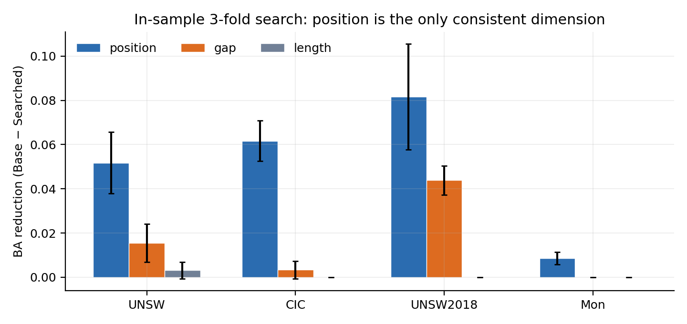
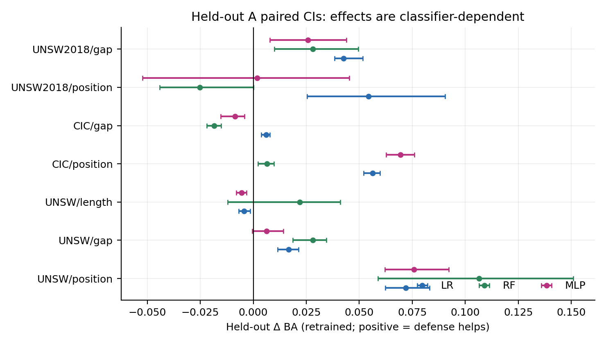
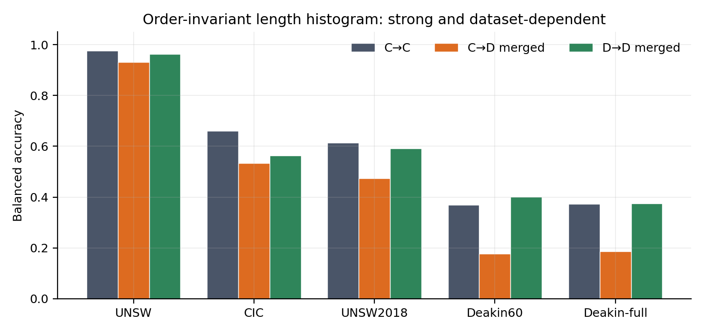
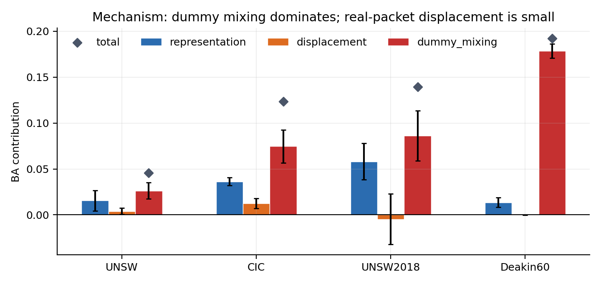
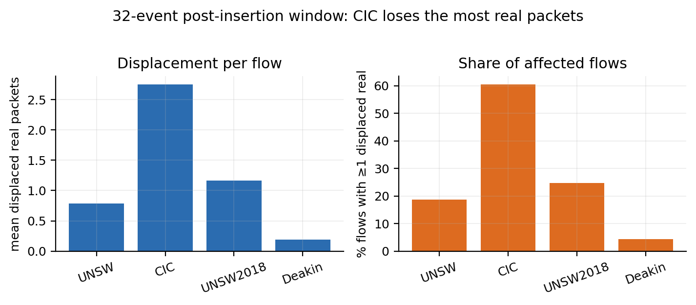
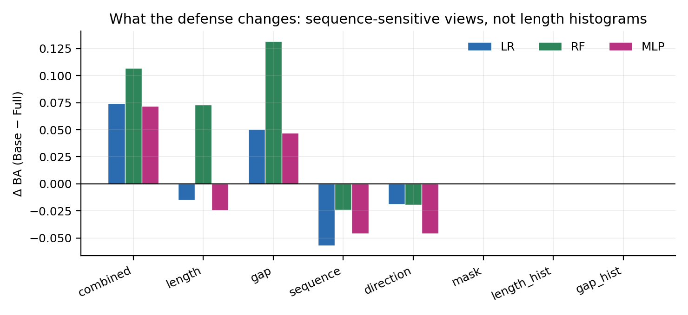

# 第一阶段总结（v2，冻结版）

> **状态：冻结。** 不再扩大搜索空间或数据集；本文件与 `v2_tables.md` 是第一阶段唯一权威汇总。
> 所有数字来自 `artifacts/es/v2_*.json`；旧 `artifacts/es/*.json` 仅作历史记录，不可与 v2 混用。

## 0. 一句话结论

> 在固定流量开销下，优化 dummy 插入位置能够降低部分顺序敏感指纹攻击的识别性能。但这种收益依赖分类器和数据集，其主要体现为攻击者观察到的流量表示发生变化，而非真实包所携带的设备身份信息被消除。

## 1. 协议边界

- 等成本：每流 +630 B / +5 events（2 trigger + 3 weakener），32 事件窗口。
- 攻击者：LR / RF / MLP；clean（干净训练）与 retrained（防御流量重训练）。
- 搜索目标：`min_theta max(BA_clean^LR, BA_retrained^LR)`，**只用 LR**；不是 LR/RF/MLP 的真正多模型 worst-case。
- 最终评估：capture-disjoint held-out A，已复用，不是盲测；B 只有 1 天。
- 数据集：UNSW-IoTraffic、CIC-9、UNSW2018-9、Deakin-10；Mon 只作弱探索。
- 逐流 RNG：内容指纹（前 20 事件，不含标签/批内下标）；chunk/order/parallel 不变量测试通过。

## 2. 核心结论

1. **position 是唯一在四个数据集都给出正向信号的维度**；但效果小、异质，且 clean 场景基本为 0。
2. **gap 的 v2 证据明显弱于旧版**：UNSW 0.0155、CIC 0.0033；只有 UNSW2018 还有 0.0439。
3. **length 基本无效**：UNSW 搜索 Δ0.0031，held-out retrained LR/MLP 甚至为负。
4. **效果依赖攻击者与数据集**：同一位置候选在 LR/RF/MLP 上差异很大，UNSW2018 position 的 RF held-out 为负。
5. **长度直方图侧信道真实存在**（C→C：UNSW 0.977、CIC 0.660、UNSW2018 0.614、Deakin 0.369），位置搜索对 `length_hist` 的 Δ 精确为 0。
6. **clean→defended 的下降主要是 dummy 混入**，不是真实包被消除；真实包位移很小，真实包 padding 的 representation 项也小。
7. **32 窗口本身是变量**：CIC 平均挤出 2.75 个真实包（60.4% 流至少 1 个），UNSW 0.79、UNSW2018 1.16、Deakin 0.19。

## 3. 证据链

### 图 1：搜索效果（in-sample 3 折）

- position：UNSW 0.0518、CIC 0.0617、UNSW2018 0.0817、Mon 0.0086；
- gap：UNSW 0.0155、CIC 0.0033、UNSW2018 0.0439；
- length：UNSW 0.0031（2/3 折）。

读法：position 的柱子最高且跨数据集都存在；gap 不稳定；length 接近 0。

### 图 2：Held-out A 配对 CI（retrained）

- UNSW position：LR 0.0718 [0.0622,0.0832]、RF 0.1065 [0.0588,0.1510]、MLP 0.0759 [0.0621,0.0921]；
- CIC position：LR 0.0563、RF 0.0064、MLP 0.0694；
- UNSW2018 position：LR 0.0543、RF −0.0252、MLP 0.0019；
- CIC/UNSW2018 的 gap 有正有负；UNSW length 的 LR/MLP CI 在 0 以下。

读法：不能用“position 对所有人都有效”概括；必须按数据集和模型报告。

### 图 3：顺序无关长度直方图

| version | C→C | C→D merged | D→D merged | C→D real |
| --- | ---: | ---: | ---: | ---: |
| UNSW | 0.977 | 0.932 | 0.964 | 0.957 |
| CIC | 0.660 | 0.535 | 0.564 | 0.611 |
| UNSW2018 | 0.614 | 0.474 | 0.591 | 0.561 |
| Deakin60 | 0.369 | 0.177 | 0.402 | 0.356 |
| Deakin-full | 0.374 | 0.187 | 0.375 | 0.354 |

读法：C→C 是内在可识别性；merged 的 C→D 下降包含 dummy 造成的分布偏移；real-only 的 C→D 损失小得多（Deakin 0.013~0.020）。

### 图 4：机制分解——dummy 混入 vs 真实包位移

| dataset | representation | displacement | dummy_mixing | total |
| --- | ---: | ---: | ---: | ---: |
| UNSW | 0.015 | 0.004 | **0.026** | 0.046 |
| CIC | 0.036 | 0.012 | **0.075** | 0.123 |
| UNSW2018 | 0.058 | −0.005 | **0.086** | 0.140 |
| Deakin60 | 0.014 | 0.000 | **0.179** | 0.192 |

- 链式顺序固定：`CC → CD_complete → CD_visible → CD_merged`；
- 三个差值是**路径依赖**的，不可交换顺序，也不是独立因果效应；
- `CD_complete` 与 clean 的差异来自真实包 padding：99% 流至少一个真实包变长，但只有 4% 事件变化（Deakin 15%），平均 +41 B/流；`padding_probability=0` 时 8000/8000 流 hist 完全一致；
- **主因始终是 dummy_mixing**。

### 图 5：32 窗口真实包位移

- CIC：平均 2.75 个、60.4% 流至少 1 个；
- UNSW：0.79 / 18.7%；
- UNSW2018：1.16 / 24.6%；
- Deakin：0.19 / 4.3%；
- 所有配置下 5 个 dummy 基本都进入窗口。

读法：CIC 的防御收益里有相当一部分来自“真实包被挤出窗口”，这是协议设计的一部分，必须单独报告。

### 图 6：攻击者视角——防御改变了什么

- retrained 下 combined Δ：LR 0.0745、RF 0.1070、MLP 0.0720；
- gap：0.0506 / 0.1316 / 0.0470；
- length：−0.0151 / +0.0731 / −0.0246；
- sequence：−0.0572 / −0.0241 / −0.0459；
- mask / length_hist / gap_hist：精确为 0。

读法：防御主要改变顺序敏感的 sequence/mask/direction 表示；对长度边际分布没有影响；某些视角甚至被防御增强。

## 4. 归因补充（UNSW）

| 实验 | 结果 |
| --- | --- |
| Position ablation | searched Δ：LR 0.0319、RF 0.1185、MLP 0.0465 |
| LOCO | class5 对 RF +0.107；class0 对 LR/MLP 为负（−0.040/−0.043） |
| Factorial c5×c6 | class5 interaction：LR −0.022 [−0.065,0.011]、RF −0.287、MLP −0.065 |

结论：效果集中在少数类，类间有干扰；不能用单类结果线性外推。

## 5. 不能声称的内容

- ❌ “搜索优化了 worst-case attacker”：目标只用了 LR。
- ❌ “Held-out 是盲测”：A 已复用；B 只有 1 天。
- ❌ “Frozen candidate 证明 v2 泛化”：frozen 没有在 v2 下重算。
- ❌ “Deakin 上位置搜索有效”：Deakin 没有做位置/长度/间隔搜索。
- ❌ “WAN 外部验证完成”：PingPong 是 LAN 采集，不是 WAN。
- ❌ “dummy 消除了真实包身份信息”：直方图 C→C 仍然很高，机制分解主因是 dummy 混入。

## 6. 第二阶段交接

冻结的候选动作库：

- `fade_unsw8_pos_v2.json`、`fade_unsw8_gap_v2.json`、`fade_unsw8_len_v2.json`
- `fade_cic9_pos_v2.json`、`fade_cic9_gap_v2.json`
- `fade_unsw2018_pos_v2.json`、`fade_unsw2018_gap_v2.json`
- `fade_mon_pos_v2.json`（仅作弱对照）

第二阶段问题：

\[
A_t \in \{A_{\text{position}}, A_{\text{gap}}, A_{\text{hybrid}}, \ldots\}
\]

比较 Static / Cyclic / Random / RL 的时间切换策略；评价指标必须同时报告 clean、retrained 与长度直方图残余。

重要：内容指纹 RNG 只保证重放一致，**不代表对攻击者不可预测**；动态防御必须引入秘密随机状态与策略选择机制。

## 7. 文件

- 自动表：[v2_tables.md](v2_tables.md)
- 协议：[评估协议.md](评估协议.md)
- 完整结论：[第一阶段实验结论.md](第一阶段实验结论.md)
- 图：[figures/phase1/](figures/phase1/)
- 结果 JSON：`artifacts/es/v2_*.json`
- 仓库：https://github.com/zzyexplorarionofcode/device-footprinting-recognision
